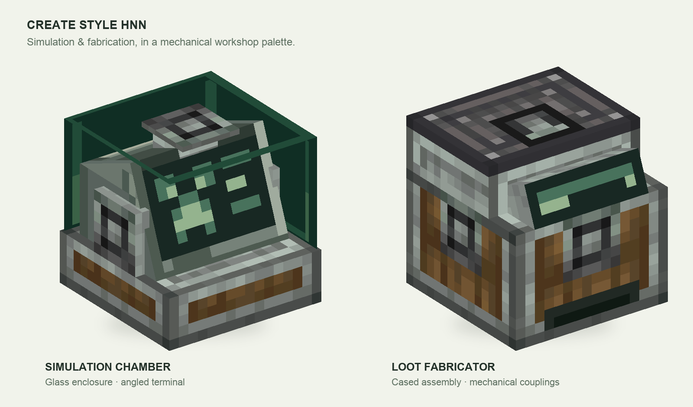
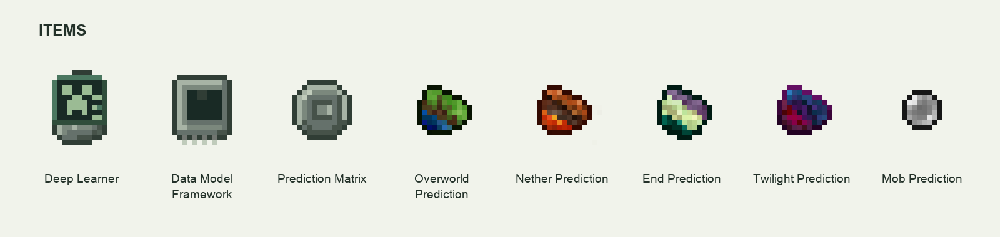

[English](README.md) | [简体中文](README.zh-CN.md)

# Create Style HNN

A Create-inspired resource pack for Hostile Neural Networks, with workshop-style Simulation Chambers, Loot Fabricators and matching items; on Minecraft 1.21.1 it also restyles the Data Center and its IO Ports. Its industrial materials and green terminals fit naturally into a mechanical factory.

*Static software render of the resource models and textures; not an in-game screenshot.*

*Item textures enlarged for visibility.*

## Requirements

One ZIP works on both versions below; Minecraft picks the matching files automatically.

| Component | Minecraft 1.20.1 | Minecraft 1.21.1 |
| --- | --- | --- |
| Minecraft: Java Edition | 1.20.1 | 1.21.1 |
| Mod loader | [Forge](https://files.minecraftforge.net/net/minecraftforge/forge/index_1.20.1.html) 47.4.10 | [NeoForge](https://neoforged.net/) 21.1.251 or newer |
| Java | [Java 17](https://adoptium.net/temurin/releases/?version=17) | [Java 21](https://adoptium.net/temurin/releases/?version=21) |
| [Create](https://modrinth.com/mod/create) | 6.0.8 | 6.0.10 |
| [Hostile Neural Networks](https://www.curseforge.com/minecraft/mc-mods/hostile-neural-networks) | 5.3.3 | 6.5.1 |
| [Placebo](https://www.curseforge.com/minecraft/mc-mods/placebo), required by HNN | 8.5.5 or newer | 9.9.2 or newer |

The Data Center and Data Center IO Port only exist in Hostile Neural Networks for Minecraft 1.21.1.

## Installation

1. Select or create a profile for **Minecraft 1.20.1 with Forge** or **Minecraft 1.21.1 with NeoForge** in your launcher, and choose the Java version listed above as its runtime.
2. Open that profile's game folder. Install **Create**, **Hostile Neural Networks** and **Placebo** for the same Minecraft version and loader in its `mods` folder. Launch this same profile.
3. Download **`create-style-hnn-1.1.0.zip`** from [Releases](https://github.com/Eldershi/create-style-hnn/releases).
4. In Minecraft, open **Options → Resource Packs → Open Pack Folder**. Put the downloaded ZIP into that folder and keep it zipped.
5. Return to the Resource Packs screen and enable **Create Style HNN**. Move it to the top of the selected packs so it takes priority over other HNN appearance packs; keep your other packs enabled.
6. Click **Done** and allow resources to reload. Enter a world with HNN installed to view the new machine and item appearances.

For multiplayer, each player enables this resource pack on their own client.

[Credits](pack/CREDITS.txt) · [Asset licenses](pack/LICENSE-ASSETS.txt)
