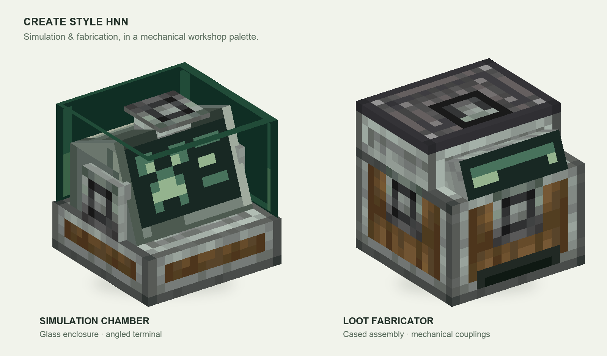
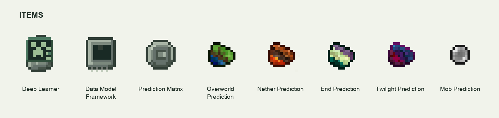

[English](README.md) | [简体中文](README.zh-CN.md)

# Create Style HNN

A Create-inspired resource pack for Hostile Neural Networks, with workshop-style Simulation Chambers, Loot Fabricators and matching items. Its industrial materials and green terminals fit naturally into a mechanical factory.

*Static software render of the resource models and textures; not an in-game screenshot.*

*Item textures enlarged for visibility.*

## Requirements

| Component | Version | Official download |
| --- | --- | --- |
| Minecraft: Java Edition | 1.20.1 | [Minecraft](https://www.minecraft.net/en-us/download) |
| Forge | 47.4.10 | [Forge for Minecraft 1.20.1](https://files.minecraftforge.net/net/minecraftforge/forge/index_1.20.1.html) |
| Java | 17 | [Eclipse Temurin 17](https://adoptium.net/temurin/releases/?version=17) |
| Create | 6.0.8, Forge 1.20.1 | [Create](https://modrinth.com/mod/create) |
| Hostile Neural Networks | 5.3.3, Forge 1.20.1 | [Hostile Neural Networks](https://www.curseforge.com/minecraft/mc-mods/hostile-neural-networks) |
| Placebo, required by HNN | 8.5.5 or newer for Forge 1.20.1 | [Placebo](https://www.curseforge.com/minecraft/mc-mods/placebo) |

## Installation

1. Select or create a **Minecraft 1.20.1 / Forge 47.4.10** profile in your launcher, and choose **Java 17** as its runtime.
2. Open that profile's game folder. Install the Forge 1.20.1 versions of **Create 6.0.8**, **Hostile Neural Networks 5.3.3** and **Placebo** in its `mods` folder. Launch this same profile.
3. Download **`create-style-hnn-1.0.0.zip`** from [Releases](https://github.com/Eldershi/create-style-hnn/releases).
4. In Minecraft, open **Options → Resource Packs → Open Pack Folder**. Put the downloaded ZIP into that folder and keep it zipped.
5. Return to the Resource Packs screen and enable **Create Style HNN**. Move it to the top of the selected packs so it takes priority over other HNN appearance packs; keep your other packs enabled.
6. Click **Done** and allow resources to reload. Enter a world with HNN installed to view the Simulation Chamber, Loot Fabricator and item appearances.

For multiplayer, each player enables this resource pack on their own client.

[Credits](pack/CREDITS.txt) · [Asset licenses](pack/LICENSE-ASSETS.txt)
