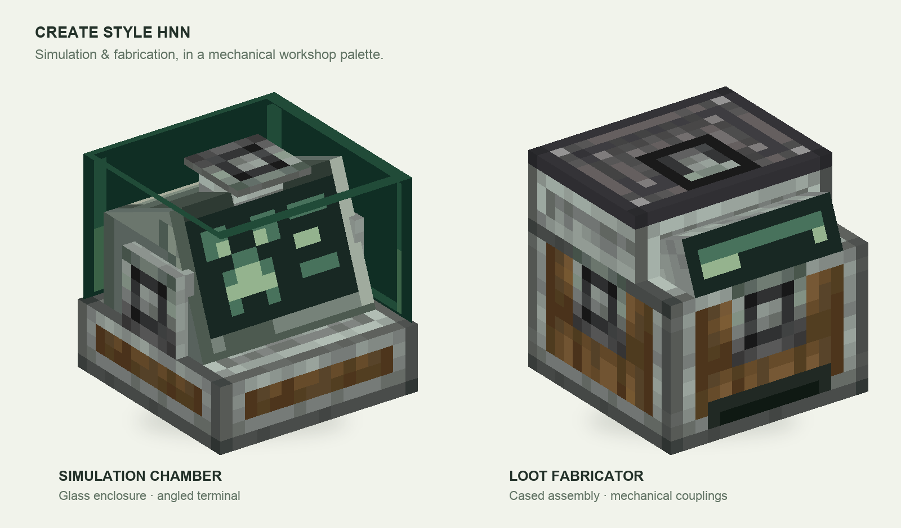
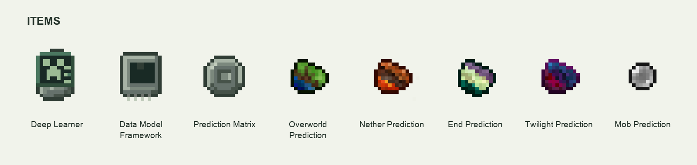

[English](README.md) | [简体中文](README.zh-CN.md)

# Create Style HNN

为敌对神经网络带来机械动力风格的模拟室、战利品制造机与配套物品外观。工业材质、绿色终端与机械工厂的环境相互呼应。

*按资源包真实模型与贴图制作的静态软件渲染预览，非游戏内截图。*

*物品贴图已放大，便于查看。*

## 运行要求

| 组件 | 版本 | 官方下载 |
| --- | --- | --- |
| Minecraft Java 版 | 1.20.1 | [Minecraft](https://www.minecraft.net/en-us/download) |
| Forge | 47.4.10 | [Minecraft 1.20.1 对应的 Forge](https://files.minecraftforge.net/net/minecraftforge/forge/index_1.20.1.html) |
| Java | 17 | [Eclipse Temurin 17](https://adoptium.net/temurin/releases/?version=17) |
| 机械动力 Create | 6.0.8，Forge 1.20.1 版 | [Create](https://modrinth.com/mod/create) |
| 敌对神经网络 HNN | 5.3.3，Forge 1.20.1 版 | [Hostile Neural Networks](https://www.curseforge.com/minecraft/mc-mods/hostile-neural-networks) |
| Placebo，HNN 所需前置 | 8.5.5 或更新的 Forge 1.20.1 版 | [Placebo](https://www.curseforge.com/minecraft/mc-mods/placebo) |

## 安装方法

1. 在启动器中选择或建立 **Minecraft 1.20.1 / Forge 47.4.10** 配置，并将运行环境设为 **Java 17**。
2. 打开这份配置实际使用的游戏文件夹，将 **Create 6.0.8**、**HNN 5.3.3** 和 **Placebo** 的 Forge 1.20.1 版 JAR 放入其中的 `mods` 文件夹，再启动同一份配置。
3. 从 [Releases](https://github.com/Eldershi/create-style-hnn/releases) 下载 **`create-style-hnn-1.0.0.zip`**。
4. 在游戏中打开 **选项 → 资源包 → 打开资源包文件夹**，将下载的 ZIP 放入该文件夹，保持 ZIP 格式即可。
5. 返回资源包页面，启用 **Create Style HNN**，并将它移到已选资源包列表顶部，使其优先于其他修改 HNN 外观的资源包；其余资源包继续保留。
6. 点击 **完成**，等待资源重新加载。进入已安装 HNN 的世界，即可查看模拟室、战利品制造机与物品外观。

多人游戏中，每位玩家在自己的客户端启用这份资源包。

[素材署名](pack/CREDITS.txt) · [素材许可](pack/LICENSE-ASSETS.txt)
