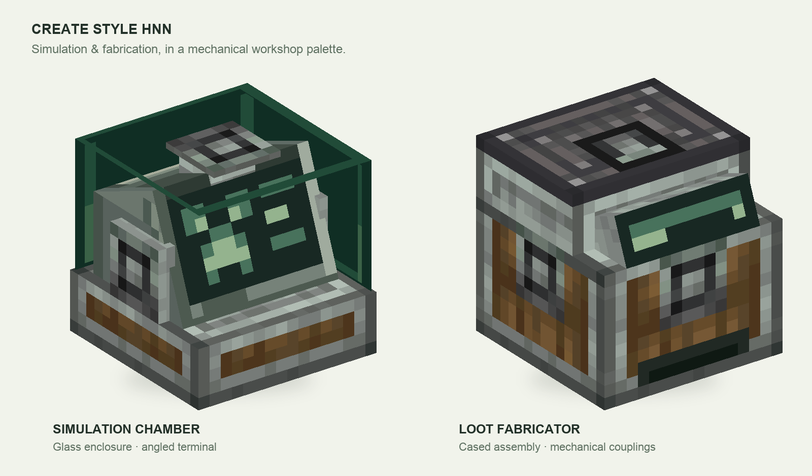
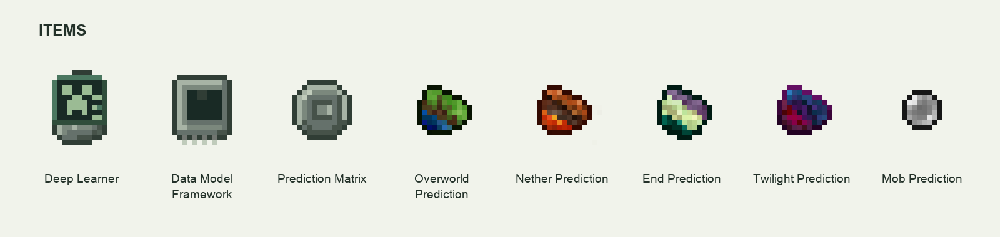

[English](README.md) | [简体中文](README.zh-CN.md)

# Create Style HNN

为敌对神经网络带来机械动力风格的模拟室、战利品制造机与配套物品外观；在 Minecraft 1.21.1 上还会改变数据中心及其 IO 端口的外观。工业材质、绿色终端与机械工厂的环境相互呼应。

*按资源包真实模型与贴图制作的静态软件渲染预览，非游戏内截图。*

*物品贴图已放大，便于查看。*

## 运行要求

同一个 ZIP 可用于下面两个版本，游戏会自动选用对应的文件。

| 组件 | Minecraft 1.20.1 | Minecraft 1.21.1 |
| --- | --- | --- |
| Minecraft Java 版 | 1.20.1 | 1.21.1 |
| 模组加载器 | [Forge](https://files.minecraftforge.net/net/minecraftforge/forge/index_1.20.1.html) 47.4.10 | [NeoForge](https://neoforged.net/) 21.1.251 或更新 |
| Java | [Java 17](https://adoptium.net/temurin/releases/?version=17) | [Java 21](https://adoptium.net/temurin/releases/?version=21) |
| [机械动力 Create](https://modrinth.com/mod/create) | 6.0.8 | 6.0.10 |
| [敌对神经网络 HNN](https://www.curseforge.com/minecraft/mc-mods/hostile-neural-networks) | 5.3.3 | 6.5.1 |
| [Placebo](https://www.curseforge.com/minecraft/mc-mods/placebo)，HNN 所需前置 | 8.5.5 或更新 | 9.9.2 或更新 |

数据中心和数据中心 IO 端口只在 Minecraft 1.21.1 版的敌对神经网络中存在。

## 安装方法

1. 在启动器中选择或建立 **Minecraft 1.20.1 + Forge** 或 **Minecraft 1.21.1 + NeoForge** 配置，并将运行环境设为上表对应的 Java 版本。
2. 打开这份配置实际使用的游戏文件夹，将与该 Minecraft 版本和加载器对应的 **Create**、**HNN** 和 **Placebo** 放入其中的 `mods` 文件夹，再启动同一份配置。
3. 从 [Releases](https://github.com/Eldershi/create-style-hnn/releases) 下载 **`create-style-hnn-1.1.0.zip`**。
4. 在游戏中打开 **选项 → 资源包 → 打开资源包文件夹**，将下载的 ZIP 放入该文件夹，保持 ZIP 格式即可。
5. 返回资源包页面，启用 **Create Style HNN**，并将它移到已选资源包列表顶部，使其优先于其他修改 HNN 外观的资源包；其余资源包继续保留。
6. 点击 **完成**，等待资源重新加载。进入已安装 HNN 的世界，即可查看新的机器与物品外观。

多人游戏中，每位玩家在自己的客户端启用这份资源包。

[素材署名](pack/CREDITS.txt) · [素材许可](pack/LICENSE-ASSETS.txt)
